<div align="center">


# Recalcula

**Controle financeiro pessoal que mostra quanto sobra antes de o mês acabar.**

Renda, contas fixas, cartões com parcelas, gastos do dia a dia e reserva em uma tela só.

[](https://github.com/victorhpriv/saldo/actions/workflows/ci.yml)


<br>

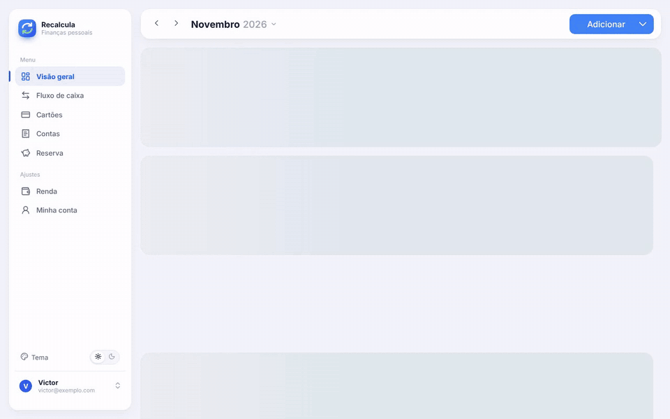

</div>

---

## Sumário

- [Sobre o projeto](#sobre-o-projeto)
- [Telas](#telas)
- [Funcionalidades](#funcionalidades)
- [Arquitetura](#arquitetura)
- [Tecnologias](#tecnologias)
- [Segurança](#segurança)
- [Como rodar](#como-rodar)
- [Estrutura de pastas](#estrutura-de-pastas)
- [API](#api)
- [Testes e CI](#testes-e-ci)
- [Próximos passos](#próximos-passos)
- [Autor](#autor)

## Sobre o projeto

Planilha de gastos costuma funcionar por uma semana. O problema é que ela mostra o que já foi gasto, e a pergunta que importa é outra: **quanto vai sobrar no fim do mês?**

O Recalcula responde isso juntando tudo o que mexe no orçamento:

- a **renda** do mês (fixa ou avulsa);
- as **contas fixas**, que se repetem sozinhas todo mês;
- as **faturas dos cartões**, com cada parcela caindo no mês certo de acordo com o fechamento;
- os **gastos do dia a dia**.

O resultado é o **saldo previsto**, recalculado a cada lançamento, com o detalhamento de para onde vai o dinheiro.

## Telas

<table>
  <tr>
    <td colspan="2">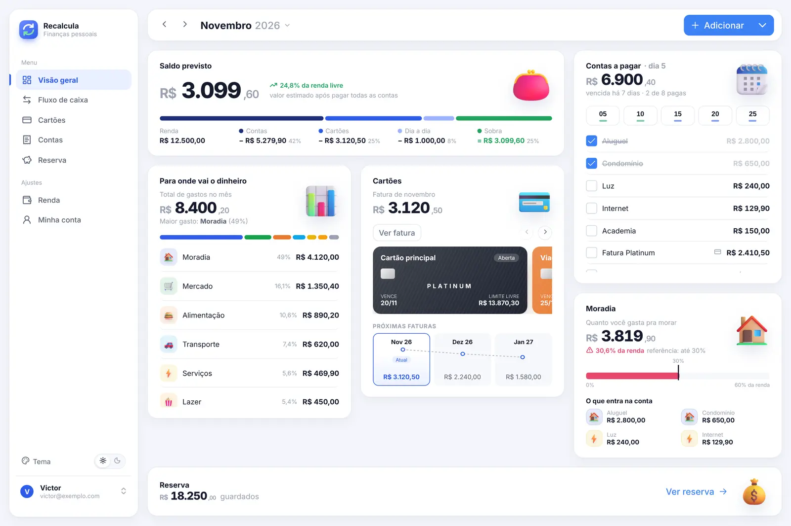</td>
  </tr>
  <tr>
    <td colspan="2" align="center"><sub><b>Visão geral:</b> saldo previsto, gastos por categoria, cartões, contas a pagar e custo de moradia</sub></td>
  </tr>
  <tr>
    <td width="50%">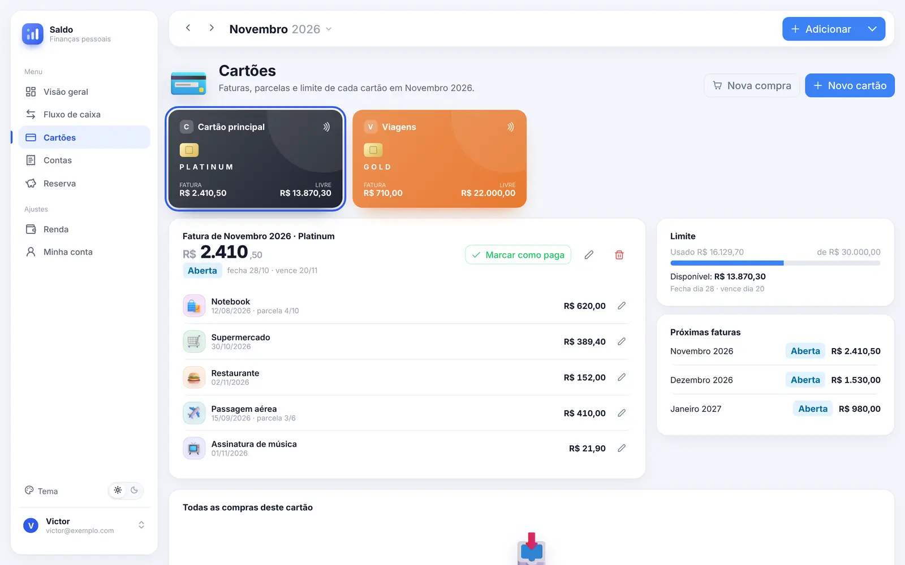</td>
    <td width="50%">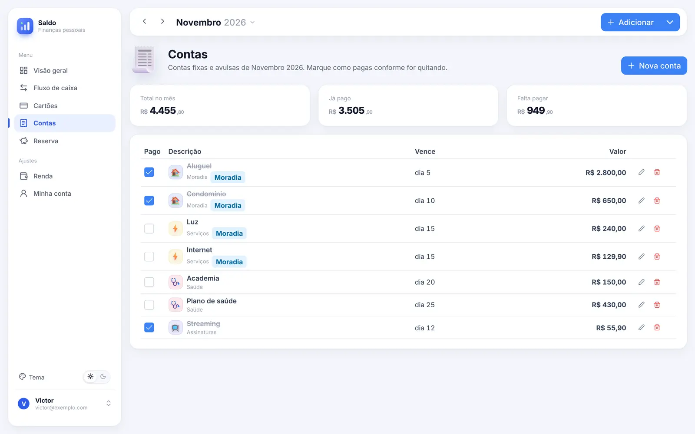</td>
  </tr>
  <tr>
    <td align="center"><sub><b>Cartões:</b> fatura, parcelas, limite e próximas faturas</sub></td>
    <td align="center"><sub><b>Contas:</b> fixas e avulsas, marcadas como pagas mês a mês</sub></td>
  </tr>
  <tr>
    <td>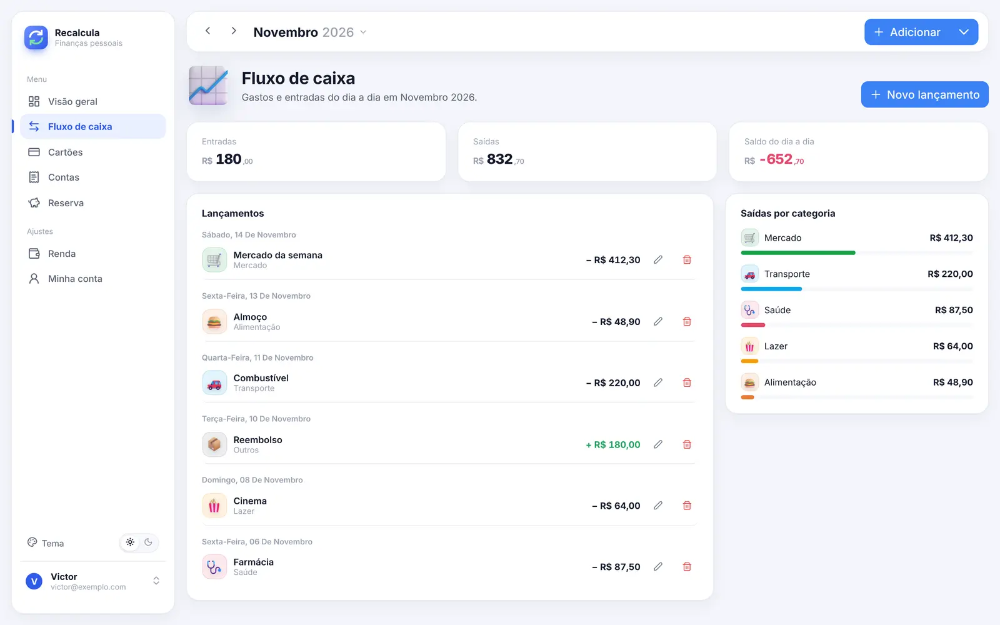</td>
    <td>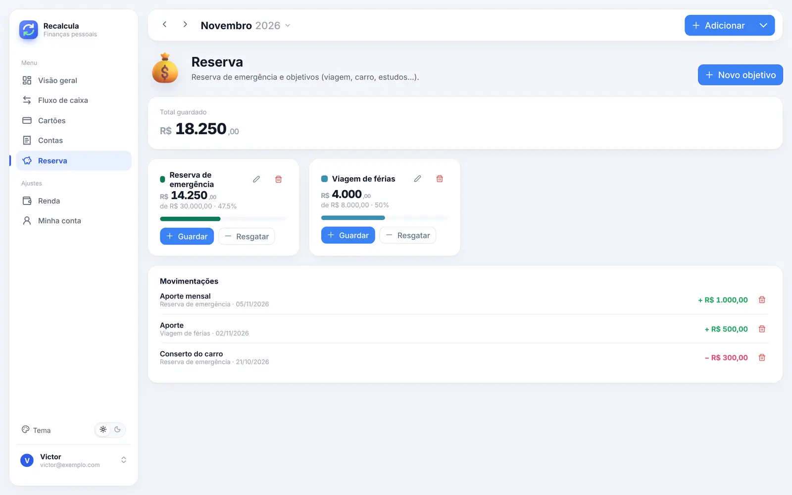</td>
  </tr>
  <tr>
    <td align="center"><sub><b>Fluxo de caixa:</b> entradas e saídas do dia a dia</sub></td>
    <td align="center"><sub><b>Reserva:</b> objetivos com meta, aportes e resgates</sub></td>
  </tr>
  <tr>
    <td>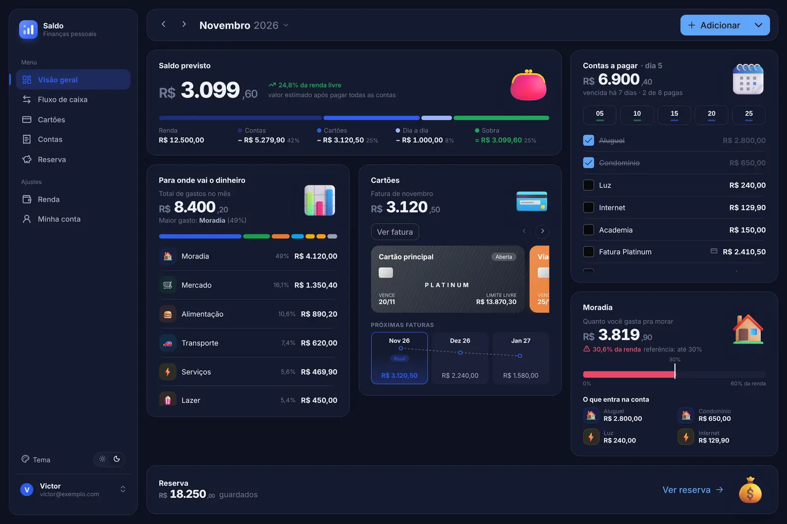</td>
    <td>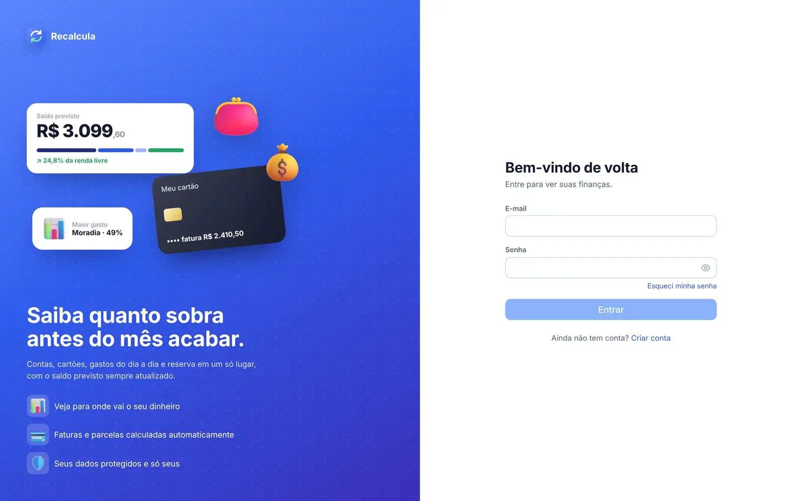</td>
  </tr>
  <tr>
    <td align="center"><sub><b>Tema escuro</b></sub></td>
    <td align="center"><sub><b>Login</b></sub></td>
  </tr>
</table>

<p align="center">
  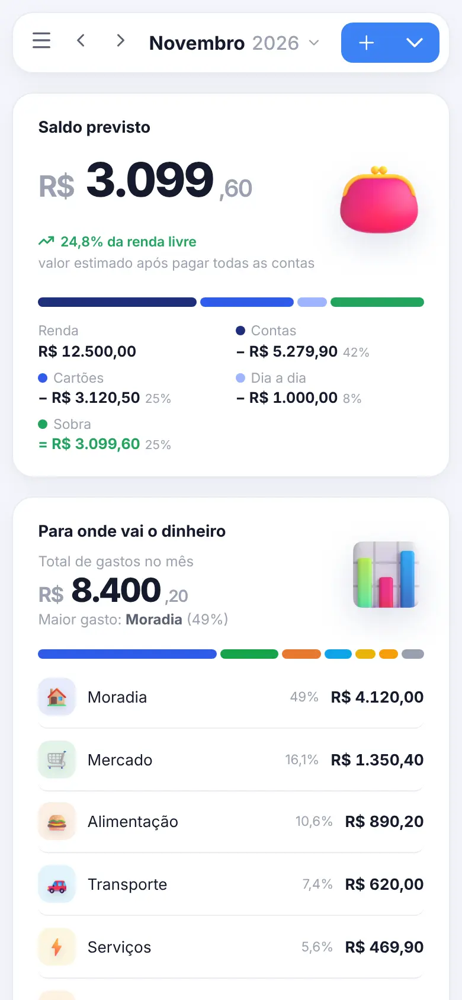
  &nbsp;&nbsp;
  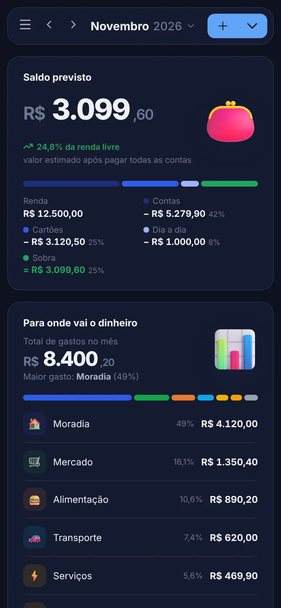
</p>

<p align="center"><sub>Layout responsivo e instalável como app (PWA)</sub></p>

<details>
<summary><b>Landing page</b></summary>
<br>

</details>

> Os valores das imagens são fictícios.

## Funcionalidades

| Tela | O que faz |
|---|---|
| **Visão geral** | Saldo previsto (renda − contas − faturas − dia a dia), gastos por categoria, cartões e próximas faturas, contas a pagar com filtro por dia de vencimento, custo de moradia comparado à referência de 30% da renda e total da reserva |
| **Fluxo de caixa** | Gastos e entradas do dia a dia, agrupados por data e por categoria |
| **Cartões** | Cartões com dia de fechamento e vencimento, compras parceladas, fatura do mês, próximas faturas, limite usado e disponível, fatura marcada como paga |
| **Contas** | Contas fixas (com mês final opcional) ou avulsas, categoria, marcação de custo de moradia e status de pagamento por mês |
| **Reserva** | Objetivos com meta, aportes e resgates |
| **Renda** | Salário e outras rendas, fixas ou avulsas |
| **Minha conta** | Nome, troca de senha, confirmação de e-mail, exportação dos dados (JSON) e exclusão da conta |
| **Acesso** | Cadastro com aceite dos termos, login, recuperação de senha por e-mail e confirmação de e-mail |

Outros detalhes:

- botão **Adicionar** no topo para lançar gasto, conta, compra no cartão ou renda de qualquer tela;
- **seletor de mês** global, para navegar pelo histórico e planejar os próximos meses;
- **checklist de primeiros passos** para quem acabou de criar a conta;
- **tema claro e escuro**, com transição animada;
- **PWA**: instala no celular e no computador. A interface fica em cache, e os dados da API nunca são cacheados.

## Arquitetura

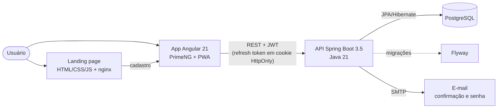

O backend é organizado **por funcionalidade** (`income`, `bill`, `card`, `cashflow`, `reserve`, `dashboard`, `auth`, `account`), e não por camada técnica. Cada pacote tem sua entidade, repositório, serviço, controller e DTOs. Isso deixa cada parte do domínio fácil de encontrar e de evoluir isoladamente.

Algumas decisões de projeto:

- **Cálculo de faturas isolado** em `InvoiceCalculator`, uma classe pura e testada. Ela decide em qual fatura cada parcela cai a partir da data da compra e do dia de fechamento.
- **Recorrência** (`Recurrence`) compartilhada por rendas e contas fixas: um registro com mês inicial e final opcional vale para todos os meses do intervalo, sem duplicar linhas no banco.
- **Valores monetários** sempre em `BigDecimal`, com o tipo `Money` centralizando escala e arredondamento.
- **Frontend sem NgModules**: componentes standalone, signals, `rxResource` para dados assíncronos e change detection zoneless.

## Tecnologias

**Backend**
- Java 21 e Spring Boot 3.5
- Spring Security com OAuth2 Resource Server (JWT HS256)
- Spring Data JPA / Hibernate
- PostgreSQL e Flyway
- Bean Validation e Problem Details (RFC 7807)
- springdoc-openapi (Swagger)
- JUnit 5

**Frontend**
- Angular 21 (standalone, signals, zoneless)
- PrimeNG 21 com tema próprio
- Lucide e Fluent Emoji 3D para ícones
- Service Worker (PWA)

**Infra**
- Docker e Docker Compose (banco, API, app e landing)
- nginx para servir app e landing
- GitHub Actions (testes, build e imagens Docker)
- Dependabot

## Segurança

- **Senhas** com BCrypt (custo 12) e política mínima (8+ caracteres, letras e números).
- **Access token JWT** de 15 minutos guardado **só em memória** no frontend, fora do `localStorage`, o que reduz o risco de roubo via XSS.
- **Refresh token** opaco em cookie `HttpOnly`, `Secure` e `SameSite=Strict`, restrito a `/api/auth`. Ele é **rotacionado a cada uso** e salvo no banco **só como hash SHA-256**. Reuso de um token já revogado (sinal de roubo) encerra todas as sessões do usuário.
- **Força bruta:** bloqueio de 15 minutos após 5 tentativas erradas e tempo de resposta igual para e-mail existente ou não.
- **Isolamento de dados:** todo registro pertence a um `user_id` obtido do token, nunca do cliente. Recursos de outro usuário retornam 404.
- **Validação** em todos os DTOs e erros no padrão RFC 7807, sem stack trace.
- **CORS** restrito às origens configuradas, com checagem de `Origin` nos endpoints que usam cookie.
- **Headers:** CSP, `X-Frame-Options: DENY`, `nosniff` e `Referrer-Policy`, no Spring e no nginx.
- **Cartões:** número, validade e CVV não são armazenados.
- **Recuperação de senha e confirmação de e-mail** com tokens de uso único (guardados só como hash), validade curta e limite de 3 e-mails por hora.
- **LGPD:** aceite dos termos registrado, exportação dos dados e exclusão definitiva da conta pelo próprio usuário.
- Segredos só por variável de ambiente e containers rodando com usuário sem privilégios.

## Como rodar

### Com Docker (recomendado)

Pré-requisito: Docker com Compose.

```bash
git clone https://github.com/victorhpriv/saldo.git
cd saldo
cp .env.example .env
# edite o .env e defina DB_PASSWORD e JWT_SECRET
# (para gerar o segredo: openssl rand -base64 48)
docker compose up --build
```

| Serviço | Endereço |
|---|---|
| App | http://localhost:8081 |
| Landing page | http://localhost:8080 |

### Em modo de desenvolvimento

Pré-requisitos: Java 21, Maven, Node.js 22+ e Docker (para o banco).

```bash
# 1. Banco
docker compose up db -d

# 2. Backend (porta 8080, perfil dev com Swagger em /swagger-ui.html)
cd backend
export DB_PASSWORD=<a mesma do .env>
export JWT_SECRET=$(openssl rand -base64 48)
mvn spring-boot:run -Dspring-boot.run.profiles=dev

# 3. Frontend (porta 4200, com proxy de /api para a 8080)
cd frontend
npm install
npm start

# 4. Landing page (estática)
cd landing
python -m http.server 8080
```

Sem `MAIL_HOST` configurado, os e-mails de confirmação e de recuperação de senha não são enviados: o link aparece no log da API.

### Variáveis de ambiente

| Variável | Para que serve |
|---|---|
| `DB_PASSWORD` | Senha do PostgreSQL |
| `JWT_SECRET` | Chave de assinatura dos tokens (mínimo de 32 bytes em Base64) |
| `CORS_ORIGINS` | Origens permitidas para o app |
| `FRONTEND_URL` | Endereço do app, usado nos links dos e-mails |
| `COOKIE_SECURE` | `true` em produção (HTTPS) |
| `MAIL_HOST`, `MAIL_PORT`, `MAIL_USERNAME`, `MAIL_PASSWORD`, `MAIL_FROM` | SMTP para envio de e-mails |

Veja o modelo completo em [`.env.example`](.env.example).

## Estrutura de pastas

```
saldo/
├── backend/                 API Spring Boot (br.com.saldo)
│   ├── auth/                login, cadastro, JWT, refresh token, proteção contra força bruta
│   ├── account/             minha conta, tokens de e-mail, exportação e exclusão (LGPD)
│   ├── income/ bill/ card/  renda, contas e cartões
│   ├── cashflow/ reserve/   dia a dia e reserva
│   ├── dashboard/           agregações da visão geral
│   ├── mail/                envio de e-mails e templates
│   ├── common/              entidade base, Money, Recurrence, categorias, erros
│   └── db/migration/        scripts Flyway
├── frontend/                App Angular
│   ├── core/                autenticação, API tipada, estado global, tema
│   ├── layout/              menu lateral, seletor de mês e botão Adicionar
│   ├── shared/              formulários, componentes de UI, pipes e utilitários
│   └── features/            uma pasta por tela
├── landing/                 site estático, termos de uso e política de privacidade
├── docs/                    imagens deste README
├── .github/                 CI e Dependabot
└── docker-compose.yml
```

## API

Com o perfil `dev`, a documentação interativa fica em `http://localhost:8080/swagger-ui.html`.

```
POST   /api/auth/register | login | refresh | logout
GET    /api/auth/me
POST   /api/auth/forgot-password | reset-password | verify-email

GET    /api/account
PUT    /api/account/profile | password
POST   /api/account/resend-verification | delete
GET    /api/account/export

GET    /api/dashboard?month=2026-12

CRUD   /api/incomes   /api/bills   /api/cash-flow   /api/cards   /api/cards/{id}/purchases
POST   /api/bills/{id}/payments?month=           DELETE (desfaz)
GET    /api/cards/{id}/invoices/{month}
POST   /api/cards/{id}/invoices/{month}/payment  DELETE (desfaz)
GET    /api/reserve   /api/reserve/goals/...
```

## Testes e CI

```bash
cd backend && mvn test
```

A cada push e pull request, o GitHub Actions:

1. roda os testes e o build do backend (`mvn verify`);
2. faz o build de produção do frontend;
3. gera as imagens Docker da API, do app e da landing.

O Dependabot mantém as dependências do Maven, do npm e das Actions atualizadas.

## Próximos passos

- [ ] Contas compartilhadas (casal e casa), em um módulo próprio, sem alterar as tabelas pessoais
- [ ] Importação de extrato (OFX/CSV)
- [ ] Lembretes de vencimento
- [ ] Metas de gasto por categoria
- [ ] Testes de integração com Testcontainers
- [ ] Bloqueio de login em Redis para rodar várias instâncias

## Autor

Feito por **Victor**, desenvolvedor full stack (Java, Spring Boot e Angular).

[](https://github.com/victorhpriv)

---

<sub>Ícones 3D: [Fluent Emoji](https://github.com/microsoft/fluentui-emoji) (Microsoft, MIT). Ícones de interface: [Lucide](https://lucide.dev) (ISC). Fonte: [Inter](https://rsms.me/inter/) (OFL 1.1). Licenças completas em [THIRD_PARTY_NOTICES.md](THIRD_PARTY_NOTICES.md).</sub>
